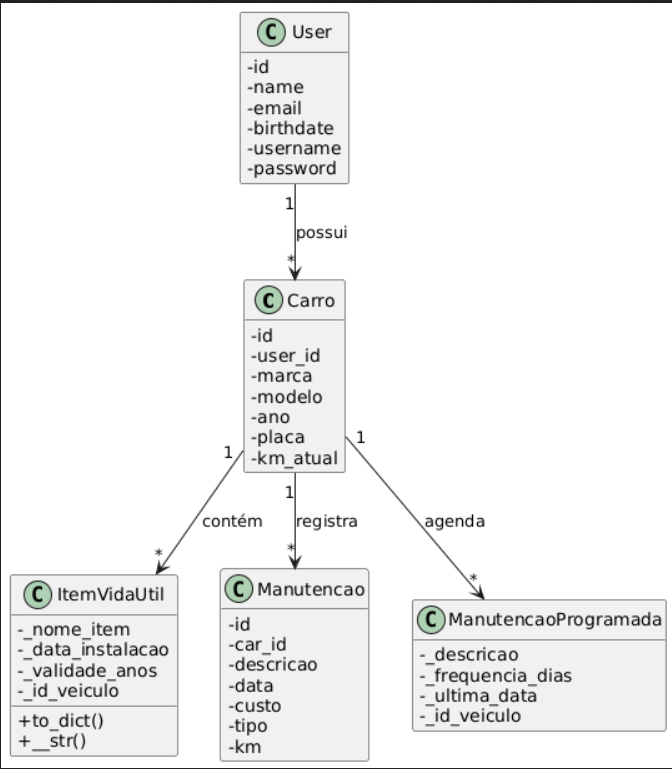

# RedLine — Sistema de Gestão e Manutenção Automotiva

O **RedLine** é uma aplicação web completa para gerenciamento de veículos, histórico de manutenções, agendamento de revisões preventivas, monitoramento de vida útil de peças/componentes e controle de abastecimentos e custos operacionais.

Desenvolvido em **Python** com arquitetura **MVC + Services** orientada a objetos, utilizando o microframework **Bottle** e persistência estruturada em **JSON**.

---

## 🚀 Principais Funcionalidades e Facilidades

- **Painel de Controle Inteligente (`/dashboard`)**:
  - Indicadores gerais da frota (total de veículos, saúde média, gastos em manutenções, gastos com combustível e custo operacional total).
  - **Central de Alertas Automáticos**: identifica revisões programadas atrasadas ou próximas do vencimento (por data ou quilometragem) e peças com vida útil crítica.
  - Resolução de alertas com **1 clique** (concluir revisão ou substituir peça diretamente pelo painel).
- **Minha Garagem & Painel 360º do Veículo (`/carros` e `/carros/<id>`)**:
  - Cálculo dinâmico do **Índice de Saúde do Veículo (0% a 100%)**.
  - **Atualização rápida de hodômetro (KM)** com 1 clique diretamente nos cards da garagem ou no painel do veículo.
  - Sincronização inteligente de KM: ao registrar uma manutenção ou abastecimento com KM superior ao atual, o hodômetro do carro é atualizado automaticamente.
- **Manutenções Programadas (`ManutencaoProgramada`)**:
  - Agendamento por **intervalo de dias** e/ou **intervalo de quilometragem**.
  - **Presets rápidos** de revisões comuns (Óleo e Filtro, Freios, Alinhamento, Arrefecimento, Correia Dentada, etc.).
  - Botão **Concluir**: registra automaticamente o serviço no histórico de manutenções realizadas e reinicia a contagem para o próximo ciclo.
- **Monitoramento de Vida Útil de Peças (`ItemVidaUtil`)**:
  - Acompanhamento de desgaste de peças por tempo de instalação e por quilometragem rodada.
  - **Gerador de Kit Essencial (1 Clique)**: adiciona automaticamente os 8 itens vitais de monitoramento para qualquer veículo.
  - Botão **Substituir Peça (100%)**: renova a peça para 100% de saúde e registra a troca no histórico do carro.
- **Controle de Abastecimentos e Consumo (`Abastecimento`)**:
  - Registro de abastecimentos com cálculo automático de preço por litro e **consumo médio em km/L**.
- **Relatórios Financeiros e Dossiê Técnico (`/relatorios`)**:
  - Comparativo de custos por veículo e por categoria de manutenção.
  - Emissão de **Dossiê Técnico do Veículo** formatado para impressão ou exportação em PDF (`window.print()`), ideal para comprovar revisões na revenda.
- **Acesso Rápido de Demonstração**:
  - Botão de **Login Demo com 1 Clique** na tela inicial (`demo@redline.com` / senha `123456`).

---

## 🗂 Estrutura de Pastas

```text
epf-RedLine/
├── app.py                          # Ponto de entrada da aplicação e configuração WSGI
├── config.py                       # Configurações globais, constantes e presets
├── Makefile                        # Atalhos para execução, limpeza e testes
├── requirements.txt                # Dependências do projeto
├── README.md                       # Documentação do projeto
├── controllers/                    # Controladores (Rotas HTTP)
│   ├── __init__.py
│   ├── auth_controller.py          # Login, login demo, cadastro e logout
│   ├── car_controller.py           # Garagem, painel 360º do veículo e hodômetro
│   ├── dashboard_controller.py     # Dashboard principal e página de relatórios
│   ├── manutencao_controller.py    # Manutenções, agendamentos, vida útil e abastecimentos
│   └── user_controller.py          # Gestão de perfil e senha do usuário
├── models/                         # Modelos de Domínio (POO)
│   ├── __init__.py
│   ├── user.py                     # Entidade User
│   ├── carro.py                    # Entidade Carro
│   ├── manutencao.py               # Entidade Manutencao
│   ├── manutencaoProgramada.py     # Entidade ManutencaoProgramada
│   ├── itemVidaUtil.py             # Entidade ItemVidaUtil
│   └── abastecimento.py            # Entidade Abastecimento
├── services/                       # Camada de Negócio e Persistência
│   ├── __init__.py
│   ├── data_manager.py             # Leitura e escrita segura dos arquivos JSON
│   ├── user_service.py             # Regras de negócio de usuários e autenticação
│   ├── car_service.py              # Regras de negócio de veículos e exclusão em cascata
│   ├── manutencao_service.py       # Histórico de manutenções e filtros
│   ├── programada_service.py       # Cálculos de vencimento e conclusão de agendamentos
│   ├── vida_util_service.py        # Cálculo de desgaste de peças e geração de kit padrão
│   ├── abastecimento_service.py    # Controle de combustível e média km/L
│   └── dashboard_service.py        # Agregação de indicadores, alertas e saúde da frota
├── utils/                          # Utilitários e Middlewares
│   ├── __init__.py
│   ├── auth_decorator.py           # Decorator @login_required e mensagens flash
│   ├── security.py                 # Hash e verificação de senhas (scrypt)
│   ├── session_middleware.py       # Gerenciamento de sessão (Beaker / Fallback nativo)
│   └── view_helper.py              # Renderização de views e formatadores (R$, KM, Datas)
├── views/                          # Templates HTML (Bottle SimpleTemplate)
│   ├── layout.tpl
│   ├── login.tpl
│   ├── signup.tpl
│   ├── dashboard.tpl
│   ├── car_list.tpl
│   ├── car_detail.tpl
│   ├── car_form.tpl
│   ├── manutencao_list.tpl
│   ├── manutencao_form.tpl
│   ├── programada_form.tpl
│   ├── vida_util_form.tpl
│   ├── abastecimento_form.tpl
│   ├── relatorios.tpl
│   └── profile.tpl
├── static/                         # Arquivos Estáticos (Front-end)
│   ├── css/
│   │   └── style.css
│   ├── img/
│   │   └── BottleLogo.png
│   └── js/
│       └── main.js
├── data/                           # Banco de Dados em JSON
│   ├── users.json
│   ├── carros.json
│   ├── manutencoes.json
│   ├── manutencoes_programadas.json
│   ├── itens_vida_util.json
│   └── abastecimentos.json
└── diagrama/
    └── Diagrama.png                # Diagrama UML de classes do projeto
```

---

## 📊 Diagrama UML de Classes



---

## ▶️ Como Executar

1. **(Opcional) Crie e ative um ambiente virtual**:
```bash
python3 -m venv venv
source venv/bin/activate  # Linux/macOS
```

2. **Instale as dependências**:
```bash
pip install -r requirements.txt
```

3. **Inicie o servidor**:
```bash
python3 -B app.py
# ou utilizando o Makefile:
make run
```

4. **Acesse no navegador**:
   - URL: [http://localhost:8080](http://localhost:8080)
   - **Conta de Demonstração**:
     - **E-mail**: `demo@redline.com`
     - **Senha**: `123456` *(ou clique no botão "Entrar com Conta Demonstração" na tela de login)*
